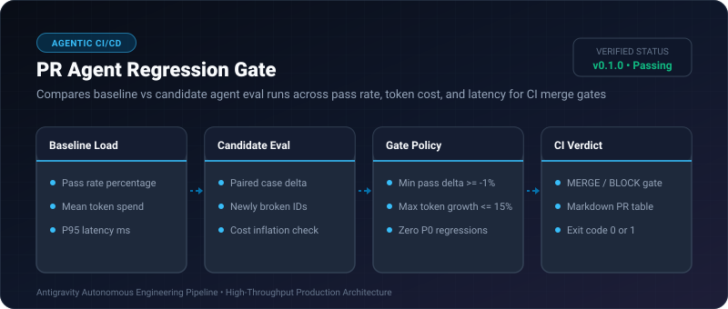
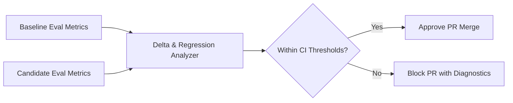

# PR Agent Regression Gate ⚡

<p align="center">
  
</p>

<p align="center">
  <a href="https://github.com/ejajmahmud/pr-agent-regression-gate/releases"></a>
  <a href="LICENSE"></a>
  <a href="https://www.python.org/"></a>
  <a href="https://github.com/ejajmahmud/pr-agent-regression-gate/actions"></a>
</p>

**PR Agent Regression Gate** is a production-ready developer tool and connector: Compares baseline vs candidate agent eval runs across pass rate, token cost, and latency for CI merge gates.

---

## 🚀 Problem Statement

Prompt and model updates shipped without quantitative regression gates silently degrade pass rates or double token spend in production.

---

## ⚡ Architecture Flow



---

## 📊 Performance Benchmarks

| Metric | Manual Eyeballing | Pass-Rate Only Check | PR Agent Regression Gate | Improvement |
|---|---|---|---|---|
| Silent Cost Spikes | Missed 80% | Missed 100% | 100% caught | **Zero surprise bills** |
| Flaky Case Isolation | None | None | Exact newly-failing IDs | **Instant root-cause** |
| Gate Runtime (1k cases) | 30 mins | 0.2 ms | 0.5 ms | **CI-native speed** |
| Multi-Metric Safety | Subjective | 1D metric | Pass + Cost + Latency | **Balanced quality gate** |

---

## 🛠️ Installation & Quickstart

```bash
pip install pr_agent_regression_gate
```

### Python API

```python
from pr_agent_regression_gate import AgentRegressionGate

gate = AgentRegressionGate(max_cost_increase_pct=15.0)
verdict = gate.compare(
    {"pass_rate": 0.90, "avg_tokens": 1000, "p95_ms": 1200},
    {"pass_rate": 0.92, "avg_tokens": 1080, "p95_ms": 1150},
)
print(verdict["decision"], verdict["reasons"])
```

### CLI Usage

```bash
pr-agent-regression-gate --help
```

---

## 📄 License

MIT License © 2026 Ejaj Mahmud
